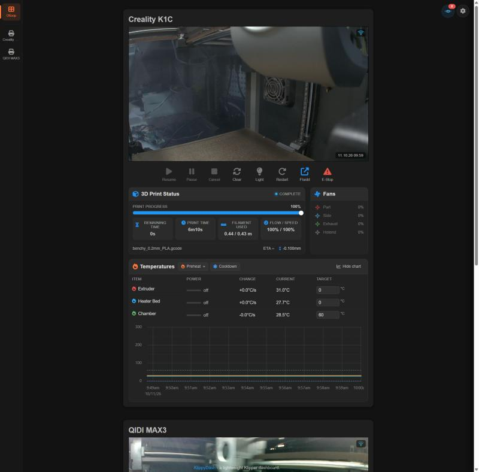
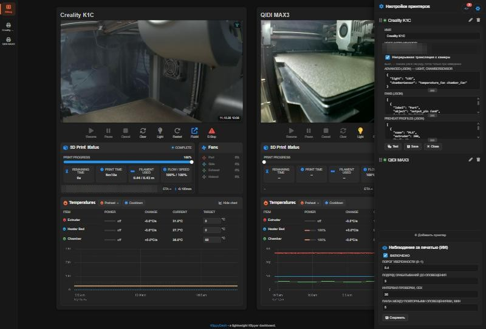

# KlippyDash-Dr

A reworked [KlippyDash](https://github.com/nixkor/KlippyDash) — a lightweight dashboard for
Klipper printers, built on the [Moonraker](https://github.com/Arksine/moonraker) API.

This fork runs in a workshop with two printers, a Creality K1C and a QIDI MAX3, and grew out
of one plain need: see both machines on a single screen and stop hopping between browser
windows. So the main difference from upstream is that the dashboard became the whole
workplace, not just an overview panel.

<p align="center">
  
</p>

## What this fork adds

**Fluidd tabs inside the page.** A rail down the left edge holds an Overview tab plus one tab
per printer. A printer tab shows that printer's Fluidd full-page. Every Fluidd is loaded at
startup and stays in the DOM, so switching is instant and Fluidd keeps its state — open tab,
scroll position, console history. One browser window for everything.

**Control bar under the camera.** Preheat profiles, cooldown, chamber light, fans, firmware
restart, emergency stop.

**Temperatures.** A Fluidd-style table and a uPlot chart with dashed intermediate gridlines
and per-series values at the cursor, each in its own line's color.

**Print status.** A dedicated card with progress, timings and the Z-offset read straight from
`gcode_move` rather than from the config file.

**Print monitoring.** The `print-watchdog` service watches the cameras through Obico's
detector and sends a Telegram message when it suspects spaghetti. An eye icon on the
dashboard shows the service state and opens the event log.

**Link status.** A connection indicator over each camera: you can see when a printer dropped
off and how long ago.

**Settings in the UI.** `settings.json` is editable on the page, no text editor needed.

<p align="center">
  
</p>

**Camera.** Snapshot mode or continuous stream, switchable per printer.

## Install

Python 3 is the only requirement. Clone, copy the example config and edit it:

```bash
git clone https://github.com/Poliakh/KlippyDash-Dr.git
cd KlippyDash-Dr
cp src/settings.example.json src/settings.json
```

Then start everything with one file:

```
start-klippydash.bat
```

It brings up three parts at once and without console windows: the local web server on `8899`,
the `ml_api` detector on `3333` and the monitoring service on `3334`. `stop-klippydash.bat`
shuts them all down, the web server included.

If you do not need monitoring, `python serve.py` is enough on its own — the dashboard works
standalone and the eye icon simply reports that the service is not running.

## Adding and configuring a printer

The easy way is the gear icon in the top right corner: **Add printer**, fill the fields,
**Save**. The **Test** button next to it checks the connection before you commit. The panel
writes the same `src/settings.json`, so editing the file by hand gives an identical result.

### Required fields

| Field | Meaning |
|---|---|
| `name` | Shown on the tile and on the side tab |
| `host` | Moonraker address with scheme and port, no trailing slash |

`host` is where people usually stumble. It must point at **Moonraker**, not at the web
interface — though on many printers these are the same thing. To check, open
`http://address:port/printer/info` in a browser: if JSON comes back, the address is right.

- Stock Klipper (mainsail/fluidd via KIAUH) — port `7125`.
- Creality K1/K1C — Moonraker is proxied by the web interface, so its address works, for
  example `http://192.168.0.10:4408`.
- QIDI — web interface on `10088`, Moonraker served from the same port.

Prefer an IP over `name.local`. mDNS drops out more often than you would like on local
networks, and the dashboard polls the printer continuously. Pin the address to the printer
in your router's DHCP reservations.

### Optional fields

**`light`** — the name of the light pin, used by the light button. It is whatever follows
`[output_pin ...]` in `printer.cfg`: `LED` on a K1C, `caselight` on a QIDI. If there is no
such section, leave the key out and the button will not appear.

**`chamberSensor`** — the chamber temperature sensor, written with its object type:
`temperature_fan chamber_fan`, `heater_generic hot`, `temperature_sensor chamber`. The full
list of names is available at `/printer/objects/list` on the same Moonraker.

**`fans`** — which fans to show and what to call them. Klipper's own names rarely mean
anything to a bystander, so the label is configured separately from the object:

```json
{ "label": "Exhaust", "object": "output_pin fan1", "color": "#66bb6a" }
```

`object` is the full Klipper name (`fan`, `output_pin fan0`, `heater_fan hotend_fan`),
`label` is what appears on screen, `color` is the icon color.

**`preheatProfiles`** — the preheat buttons. `extruder` and `bed` are required; `chamber`
only matters if a chamber sensor exists. `nozzleAfterBed` is the temperature the nozzle rises
to *after* the bed reaches its target: when printing ABS or ASA the nozzle is kept lower while
the chamber heats up, so filament is not cooked in a hot, idle nozzle.

**`cameraStream`** — `true` switches from one snapshot per second to a continuous stream.
Streaming loads both the network and the printer's board, so it is off by default; without it
the video starts on mouse hover.

### Global settings

`ajaxTimeout` is how long to wait for a printer to answer, in milliseconds. The `monitoring`
block belongs to the watchdog service: detector confidence threshold, how many consecutive
hits are needed to raise an alert, the polling interval and the pause between repeat
notifications.

Changes saved from the panel are picked up automatically. If you edited the file by hand,
reload the page.

## Telegram notifications

Copy the example and fill in your own values:

```bash
cp print-watchdog/telegram_config.example.json print-watchdog/telegram_config.json
```

The file is excluded through `.gitignore` and never reaches the repository. See
[print-watchdog/README.md](print-watchdog/README.md) for details.

## Configuration files

Everything that differs between installations lives in two files, and neither is in the
repository — each ships as an `.example` placeholder with the same structure:

| Real file (git-ignored) | Example in the repo | Holds |
|---|---|---|
| `src/settings.json` | `src/settings.example.json` | Printers: addresses, names, preheat profiles, fans, chamber sensor, light pin, monitoring thresholds |
| `print-watchdog/telegram_config.json` | `print-watchdog/telegram_config.example.json` | Telegram bot token and chat id |

They are deliberately kept apart. The dashboard serves `settings.json` over the LAN through
`/api/settings` so the watchdog and the in-page settings editor can read it; a bot token in
that file would be readable by anything on the network.

Also not stored here: the event log and service logs.
Addresses and job names are blurred in the screenshots above for the same reason.

## Origin and licenses

Based on [KlippyDash](https://github.com/nixkor/KlippyDash) by nixkor; its license is in
[LICENSE](LICENSE). Upstream is wired up as the `upstream` remote, so updates come in with a
plain `git fetch upstream`.

The failure detector in `print-watchdog/ml_api/` is a vendored copy from the
[Obico](https://github.com/TheSpaghettiDetective/obico-server) project, AGPL-3.0, and belongs
to its authors.
